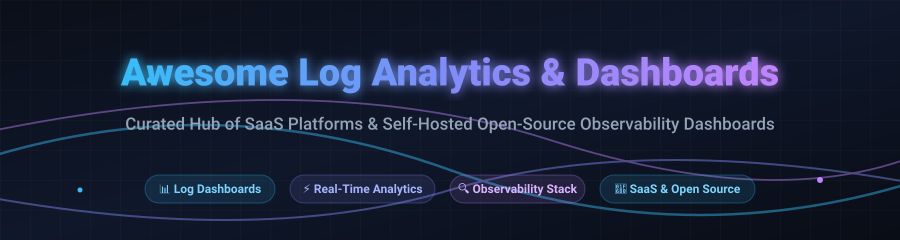

# 📊 Awesome Log Analytics & Dashboards 

  

  
  
  
  
  
  

## 🚀 Top Log Analytics & Dashboards Ecosystem

**Curated List of SaaS Products & Open-Source GitHub Projects**  
*Focused on Log Exploration, Real-Time Telemetry Visualization, SIEM, & Self-Hosted Analytics Platforms*  
**Last updated: October 2026**

---

This curated repository tracks notable **SaaS observability platforms** and **open-source log analytics projects**. These tools transform raw log streams, telemetry events, and system traces into searchable, actionable visual insights—empowering DevOps, SREs, SecOps, and platform engineering teams to investigate incidents, conduct root-cause analysis, and build real-time monitoring dashboards before outages impact users.

- **Enterprise & SaaS Category Leaders:** Splunk, Datadog, Elastic Cloud, Sumo Logic, Coralogix, Mezmo, Humio, Better Stack, and Graylog Cloud.
- **Open-Source & Self-Hosted Highlights:** Anchored by universal visualization standards and cloud-native backends including **Grafana**, **Apache Superset**, **SigNoz**, **Grafana Loki**, **Vector**, **OpenObserve**, and **Kibana**.

---
## 📑 Table of Contents

- [📈 Sector Overview & Market Dynamics](#-sector-overview--market-dynamics)
- [☁️ SaaS/Hosted Platforms](#️-saashosted-platforms)
- [🛠️ Open-Source GitHub Projects](#️-open-source-github-projects)
- [🤝 How to Contribute](#-how-to-contribute)
- [💖 Support & Community](#-support--community)
- [⭐ Star History](#-star-history)
- [📜 Disclaimer](#-disclaimer)

## 📈 Sector Overview & Market Dynamics

The global log management and analytics market is estimated at **$3.3B–$4.3B** and projected to surpass **$10B+ by the early 2030s** (11–13% CAGR). The sector is **moderately fragmented with low-to-moderate concentration** rather than winner-take-all: while enterprise SIEM and observability incumbents (Datadog, Splunk, Elastic) capture sizable enterprise spend, the pain of punitive ingestion pricing and sheer telemetry volume growth fuel healthy, continuous adoption of cost-effective alternatives and self-hosted open-source stacks.

## ☁️ SaaS/Hosted Platforms

| Product | Description | Pricing | Free Tier Limit | Company Size (Revenue/Valuation) |
| :--- | :--- | :--- | :--- | :--- |
| **[Datadog](https://www.datadoghq.com/)** | Full observability platform with logs integrated alongside metrics, traces, and dashboards. | Logs billed separately for ingest and indexing; overage at **50% premium**. Indexed logs approximately **$0.10/GB** plus event-based indexing fees. | **Infrastructure Free**: Up to 5 hosts with 1-day metric retention. Does **not** include log management. | **$3.672B TTM revenue** (ending March 31, 2026) . |
| **[Splunk](https://www.splunk.com/)** | Enterprise log analytics standard with SPL for correlation, dashboards, and SIEM. | Splunk Cloud Platform: **$150–$225/GB/day** list (negotiated $100–$180/GB/day); Splunk Enterprise self-hosted: **$1,800–$2,700/GB/day** annual list. | **Splunk Free**: 500 MB/day indexing, single instance, no alerting or user authentication. 60-day Enterprise Trial available. | **~$3.5B+ revenue** (Cisco-owned; publicly traded pre-acquisition). |
| **[Elastic Cloud](https://www.elastic.co/cloud/)** | Managed Elasticsearch, Kibana dashboards, and full-text search. | **Standard**: $99/month; **Gold**: $114/month; **Platinum**: $131/month; **Enterprise**: $184/month (based on 120 GB storage/2 zones). | **14-day free trial** on Elastic Cloud. Self-managed Elasticsearch/Kibana is free (basic tier). | **~$1.74B revenue** (FY2026, ending April 2026) . |
| **[Coralogix](https://coralogix.com/)** | Observability platform with TCO-based pricing and AI-assisted analytics. | **1 unit = $1.50** usage. Logs: High priority **0.75 units/GB**, Medium **0.32/GB**, Low **0.12/GB**. | **Coralogix Free**: 1 GB/day logs, 3 days retention, 1 user. | **$1.6B valuation**; **~$100M revenue** (Series F, June 2026) . |
| **[Sumo Logic](https://www.sumologic.com/)** | Cloud-native log analytics with security and observability dashboards. | List pricing **$100–$180/GB/day**. Flex pricing available at **$3.14/TB scanned** with zero ingest cost. | **60-day free trial** with full access to self-service plans. No permanent free tier. | **$1.19B valuation**; **~$301M revenue** (2026) . |
| **[Mezmo (LogDNA)](https://www.mezmo.com/)** | Log management with live tail, parsing, and alerting. | Starting at **$10/month** for basic plans; scales with volume. | **Mezmo Free**: 50 MB/day, 3-day retention, 1 user. | **$60M total funding**; ARR growth 2.6x (as of Series C). Revenue not publicly disclosed . |
| **[Humio (CrowdStrike)](https://www.humio.com/)** | Streaming log management with unlimited ingest plans and fast search. | Humio Cloud: **~$778/year** for 1 GB/day subscription (Band 6). Enterprise pricing via CrowdStrike. | **Humio Community Edition**: 16 GB/day ingest, 7-day retention, free for self-hosted. | **~$5M–$10M revenue** (standalone estimate; CrowdStrike subsidiary) . |
| **[Loggly (SolarWinds)](https://www.loggly.com/)** | Cloud log management with search and dashboards, part of SolarWinds observability suite. | Starting at **$79/month**. Tiered by volume (1 GB/day to 20+ GB/day). | **Loggly Free**: 200 MB/day ingestion, 7-day retention, single user. | Subsidiary of **SolarWinds** (private, PE-owned). Exact Loggly revenue not disclosed. |
| **[Graylog Cloud](https://www.graylog.org/)** | Mature enterprise log management with security correlation and dashboards. | **Cloud Operations**: $1,250/month for 10 GB/day; **Cloud Security**: $1,550/month for 10 GB/day. | **Graylog Open**: Free self-hosted, unlimited logs (requires infrastructure). **Cloud**: 30-day free trial. | Private; revenue not disclosed. |
| **[Better Stack Logs](https://betterstack.com/logs)** | Developer-friendly log management with dashboards and alerting. | **Free**: 3 GB/month each of logs/traces/events, 3-day retention. **Nano bundle**: $30–$105/month for 40 GB each; **Micro**: $120–$420/month. | **Free plan**: 3 GB/month each of logs, traces, and web events, retained 3 days. | Private; revenue not disclosed. |

## 🛠️ Open-Source GitHub Projects

- **[Grafana](https://github.com/grafana/grafana)**   
  **The universal dashboard platform.** ~77.5k stars. Connects to virtually any data source—Loki, Elasticsearch, Prometheus, ClickHouse, Postgres—and renders unified dashboards. Best for teams that want one visualization layer across logs, metrics, and traces regardless of backend.

- **[Apache Superset](https://github.com/apache/superset)**   
  **Modern enterprise business intelligence and data exploration platform.** ~75.3k stars. Connects to SQL-speaking databases and data warehouses (ClickHouse, Trino, Postgres, DuckDB) storing log analytics and metrics. Best for teams wanting rich log analytics and analytical dashboards alongside enterprise BI visualizations in one unified system.

- **[SigNoz](https://github.com/SigNoz/signoz)**   
  **The OpenTelemetry-native observability platform.** ~32.4k stars. Combines logs, metrics, and traces in a unified UI with ClickHouse storage and built-in dashboards. Best for teams standardized on OpenTelemetry that want a single backend and visualization layer for all telemetry signals.

- **[Grafana Loki](https://github.com/grafana/loki)**   
  **Horizontally scalable, highly available, multi-tenant log aggregation system.** ~29.0k stars. Inspired by Prometheus, it indexes only metadata labels rather than full text, making it extremely cost-efficient when paired directly with Grafana dashboards for log exploration.

- **[Vector](https://github.com/vectordotdev/vector)**   
  **High-performance observability data pipeline.** ~22.8k stars. Built in Rust to ingest, transform, enrich, and route huge volumes of log data and metrics into visualizer backends like Elasticsearch, Grafana Loki, ClickHouse, or cloud destinations with sub-millisecond latency.

- **[OpenObserve](https://github.com/openobserve/openobserve)**   
  **The full observability platform with built-in dashboards.** ~22.5k stars. AGPL-3.0 licensed. Covers logs, metrics, traces, LLM observability, and synthetics with SQL/visual query builders and built-in dashboard panels storing data on object storage (S3/MinIO). Best for teams wanting an all-in-one platform without assembling Kibana + Grafana + separate backends.

- **[Kibana](https://github.com/elastic/kibana)**   
  **The Elastic Stack visualization standard.** ~21.3k stars. Your window into Elasticsearch—search, dashboards, visualizations, and Canvas for pixel-perfect reports. Tightly coupled to Elasticsearch as the data backend. Best for teams already using Elasticsearch who want the most mature log exploration UI with Lens for drag-and-drop visualization.

- **[VictoriaMetrics](https://github.com/VictoriaMetrics/VictoriaMetrics)**   
  **High-performance time series database and VictoriaLogs UI.** ~17.9k stars. Includes VictoriaLogs for high-throughput, cost-efficient log management with low RAM consumption and integrated Web UI log exploration, compatible with Grafana dashboards.

- **[OpenSearch](https://github.com/opensearch-project/OpenSearch)**   
  **Community-driven, open-source search and analytics suite.** ~13.9k stars. Apache 2.0 licensed distributed search and analytics engine derived from Elasticsearch, serving as the core storage and query engine for log analytics at scale.

- **[Fluentd](https://github.com/fluent/fluentd)**   
  **Unified logging layer and CNCF graduated project.** ~13.6k stars. Decouples data sources from backend storage and visualization layers with a rich ecosystem of 1,000+ plugins for log filtering, routing, and structuring.

- **[Quickwit](https://github.com/quickwit-oss/quickwit)**   
  **The object-storage-native search engine.** ~11.7k stars. Sub-second full-text search on 100TB+ datasets with dramatic TCO reduction vs Elasticsearch. Includes a built-in UI for log exploration and native Jaeger/Grafana integrations. Best for teams prioritizing search performance and cost efficiency on object storage.

- **[HyperDX](https://github.com/hyperdxio/hyperdx)**   
  **Developer-friendly observability platform.** ~10.0k stars. Open-source alternative to Datadog that unifies logs, metrics, traces, and session replays with ClickHouse storage and intuitive dashboards designed specifically to speed up debugging.

- **[Fluent Bit](https://github.com/fluent/fluent-bit)**   
  **Fast, lightweight log processor and forwarder.** ~8.2k stars. Highly efficient C-based log and metrics collector designed for Kubernetes, embedded systems, and containerized architectures, seamlessly forwarding to Kibana, OpenSearch, and Grafana Loki.

- **[Graylog](https://github.com/Graylog2/graylog2-server)**   
  **The mature enterprise log management platform.** ~8.2k stars. **License note**: Graylog Open is distributed under **SSPL** (Server Side Public License)—not OSI-approved open-source; more accurately described as open-core or source-available. Integrated search, dashboards, alerting, and stream processing with security correlation and asset intelligence.

- **[OpenSearch Dashboards](https://github.com/opensearch-project/OpenSearch-Dashboards)**   
  **Open-source visualization and dashboard UI for OpenSearch.** ~2.1k stars. The Apache 2.0 fork of Kibana, providing interactive data visual analytics, Discover log explorer, alerting management, and multi-tenant dashboards without licensing constraints.

## 🤝 How to Contribute

1. 🍴 Fork the repository.
2. 📝 Add or edit entries in `README.md` (following the existing table or list format).
3. 🔍 Include: name, link, 1–2 sentence description, transparent pricing / limits, and whether it's SaaS or open-source.
4. 🚀 Submit a PR with a concise, helpful explanation.

Star ⭐ the repo if you find this curated collection useful!

---

## 💖 Support & Community

Thank you so much for exploring this curated repository! If this log analytics & dashboards guide has helped you or your engineering team choose the right observability stack, please consider supporting the project:

- ⭐ **Star this repository** to help others discover it across GitHub.
- 🍴 **Fork and contribute** updates or new log tools to keep the ecosystem fresh.
- 📢 **Share it** with fellow SREs, DevOps engineers, and cloud architects.
- ☕ **Buy a coffee & sponsor**: Support continuous maintenance and open-source research via the [GitHub Sponsor Dashboard](https://github.com/sponsors/ishandutta2007).

---

## ⭐ Star History

---

## 📜 Disclaimer

- 📌 This is a **community-curated** list — not exhaustive and not an official vendor endorsement.
- 💸 **Pricing scales dramatically with volume**: Splunk at 200 GB/day can cost $120,000–$200,000 annually; Graylog Cloud at the same volume is $5,000–$6,500/month. Always model your actual ingest volumes before committing.
- ⏳ **Free tiers are for evaluation, not production**: Splunk Free lacks alerting; Datadog Free excludes logs; Sumo Logic and Elastic offer trials only. Verify limits before relying on free plans.
- ⚖️ **Graylog Open is SSPL-licensed**: Distributed under Server Side Public License (SSPL)—source-available / open-core rather than OSI-approved open source. The free tier covers basic log aggregation and alerts; SIEM capabilities are in the paid Graylog Security tier.
- 🏢 **Company size data varies in reliability**: Public company revenues (Datadog, Elastic) are derived from official filings. Private company figures (Coralogix, Sumo Logic) reflect public funding announcements. Loggly and Mezmo revenues are not standalone disclosed.
- 🖥️ **Open-source visualizers still require infrastructure**: Kibana, Grafana, SigNoz, and OpenObserve all require server compute, storage disks, and engineering maintenance—free software does not mean zero operational expense.

---

  <b>Made with ❤️ for SREs, platform engineers, and developers building observability dashboards.</b> 
  <i>Let's make log analytics more open, visual, and appropriately scoped.</i>

